# Lab6Web
# LAPORAN PRAKTIKUM JAVASCRIPT DOM dan EVENT HANDLING
* **`Nama`** : Restu Aji Prasetyo
* **`NIM`**  : 312510034
* **`Kelas`**: I253C

# Berikut adalah hasil dari Praktikum dengan perubahan step by step nya
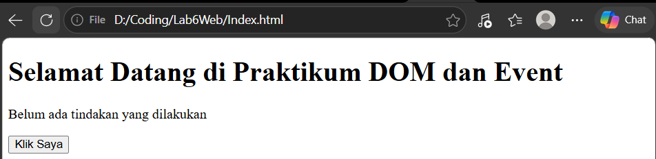
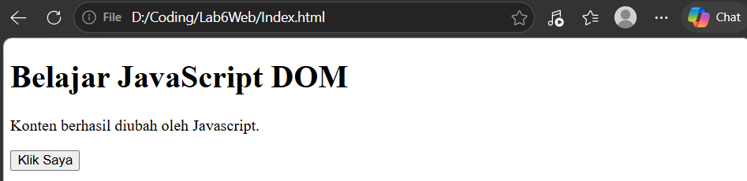
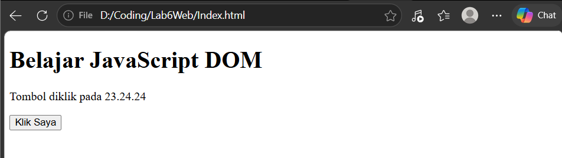
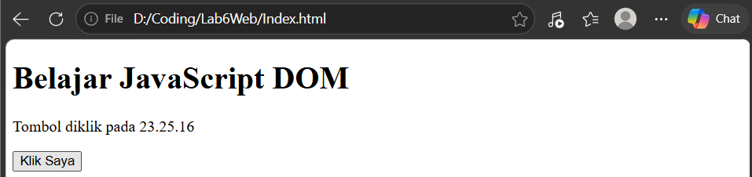
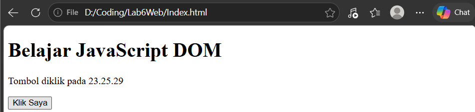
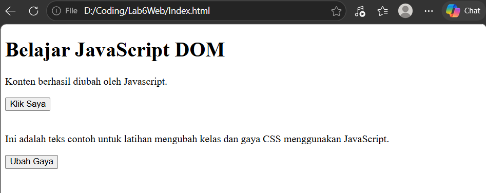
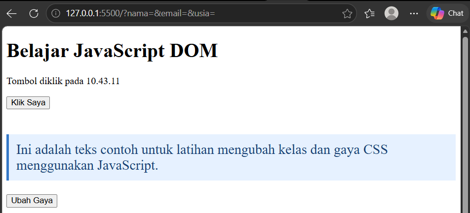
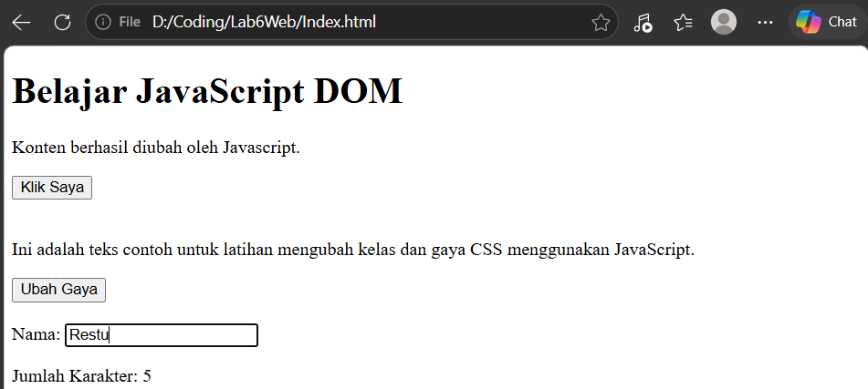
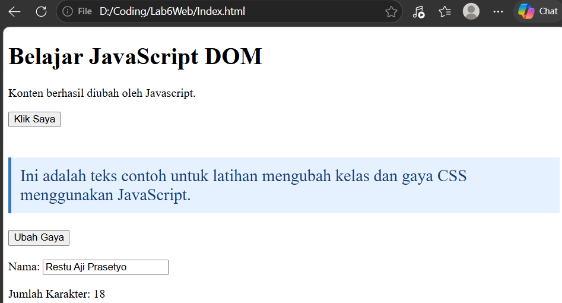
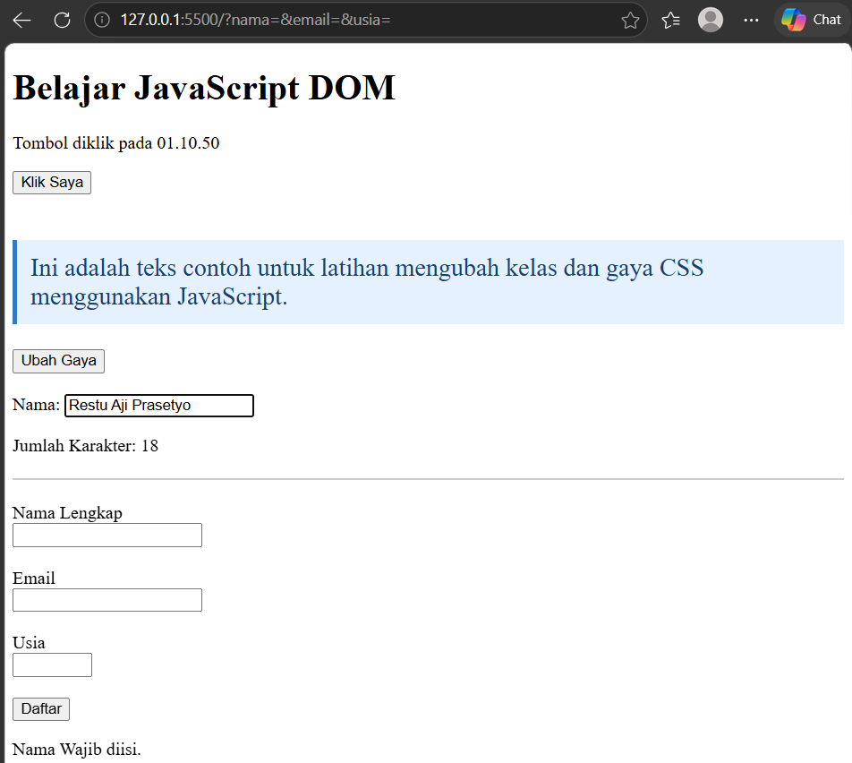
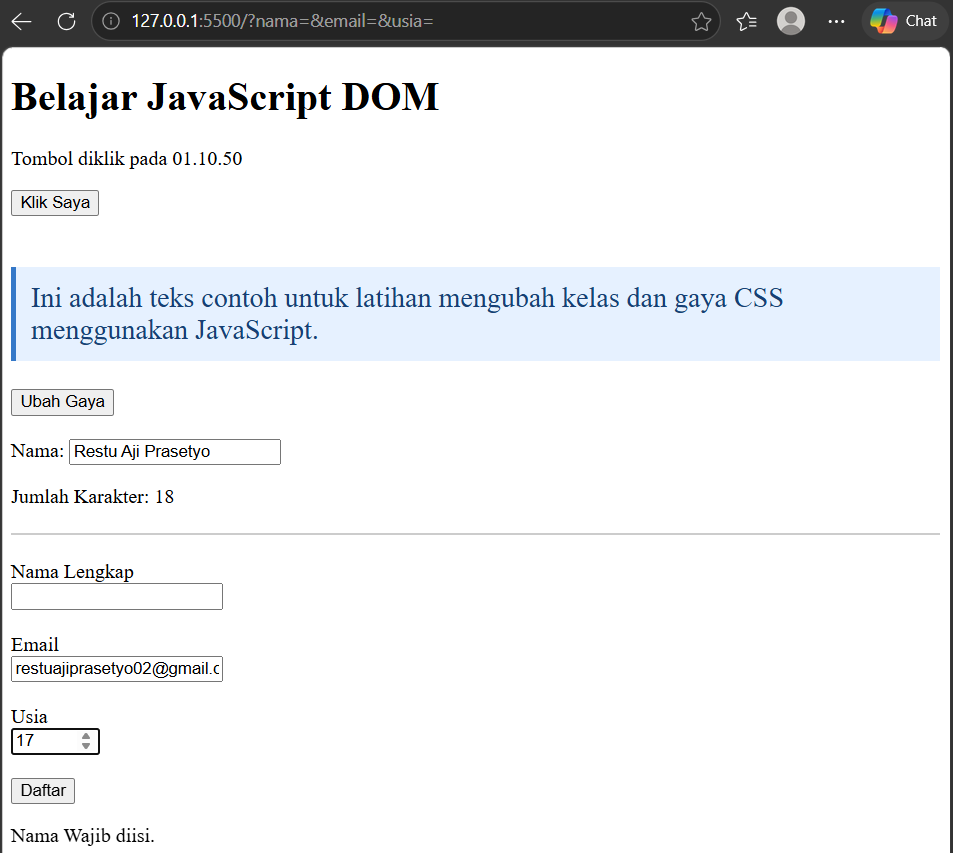
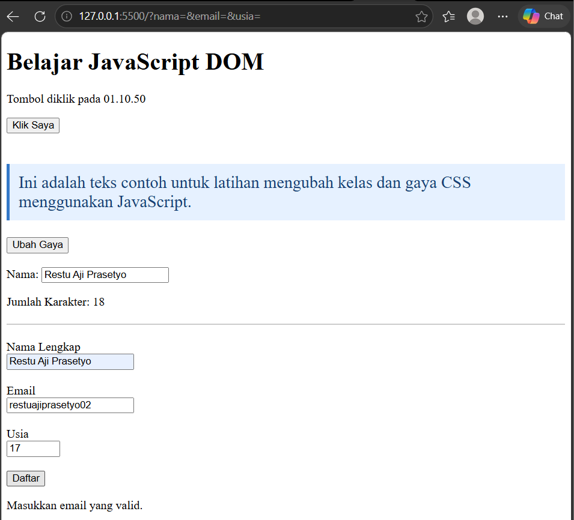
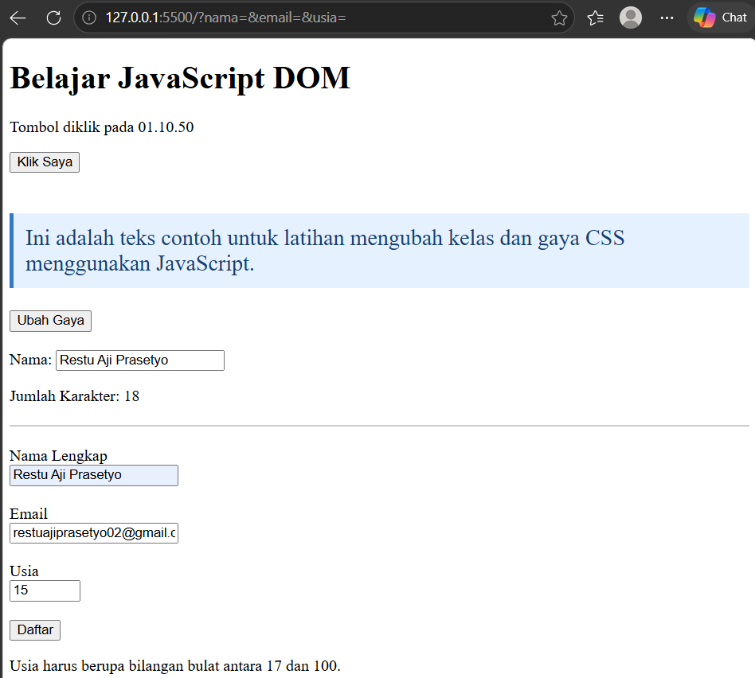
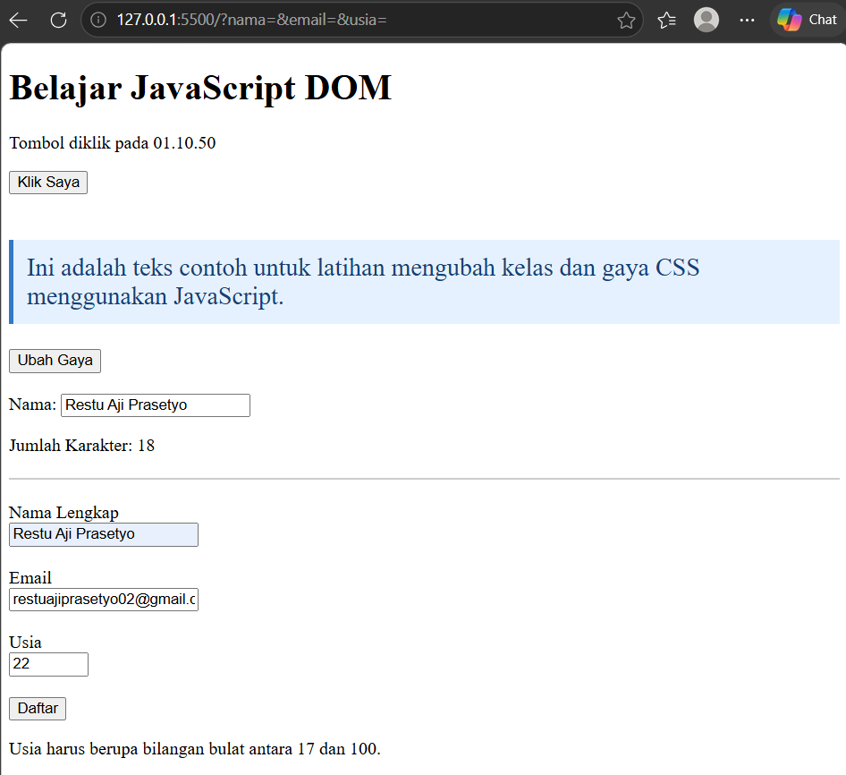
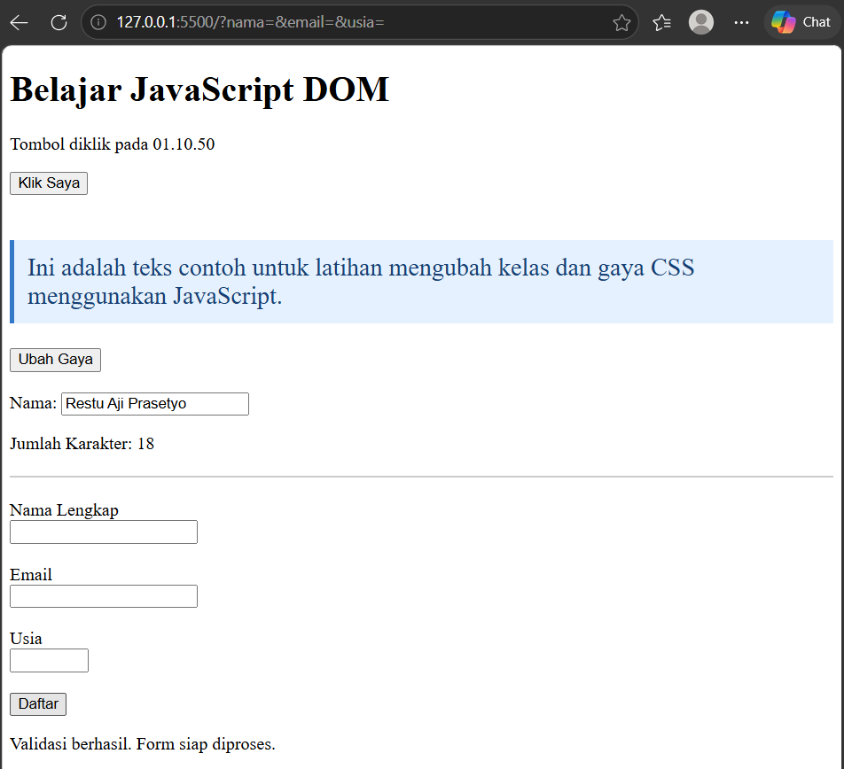
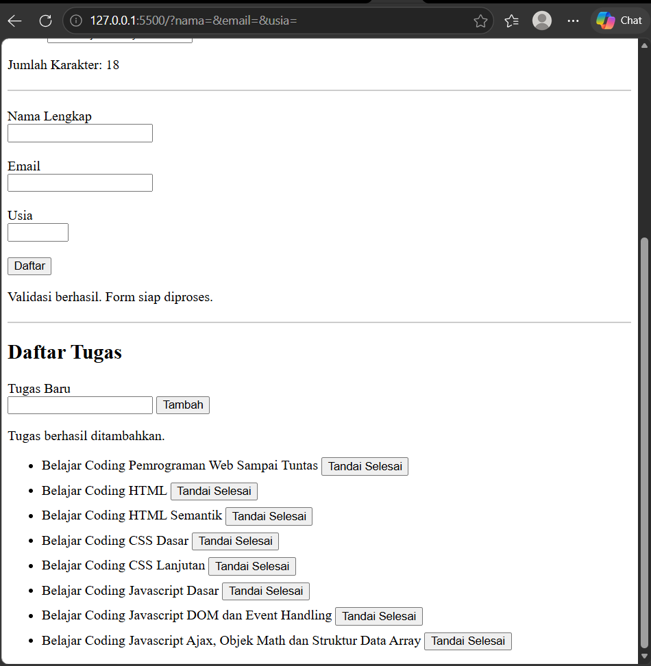
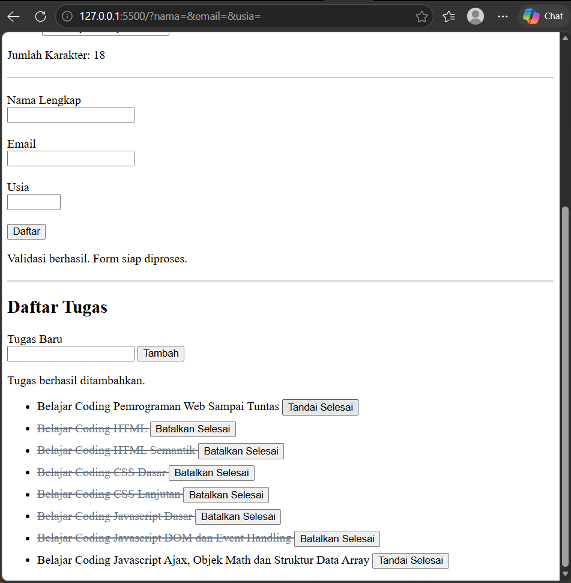

Berikut adalah jawaban untuk pertanyaan evaluasi:

1. **Apa yang dimaksud dengan DOM dan apa manfaatnya?**
* **DOM (Document Object Model)** adalah antarmuka pemrograman yang merepresentasikan dokumen HTML ke dalam bentuk struktur pohon (tree structure) sehingga setiap elemen di dalamnya dapat diakses dan dimanipulasi oleh bahasa pemrograman seperti JavaScript.
* **Manfaatnya:** Memungkinkan pengembang web membuat halaman web yang dinamis dan interaktif, seperti mengubah teks, menambah atau menghapus elemen, memodifikasi gaya CSS, serta merespons tindakan pengguna secara langsung tanpa harus memuat ulang halaman.

2. **Apa perbedaan getElementById(), querySelector(), dan querySelectorAll()?**
* **`getElementById()`**: Digunakan untuk memilih **satu elemen unik** secara spesifik berdasarkan nilai atribut `id`-nya.
* **`querySelector()`**: Digunakan untuk memilih **elemen pertama** yang cocok dengan pemilih (selector) CSS tertentu (bisa berupa kelas, tag, atau ID).
* **`querySelectorAll()`**: Digunakan untuk memilih **semua elemen** yang cocok dengan selector CSS tertentu dan mengembalikannya dalam bentuk koleksi daftar (NodeList).

3. **Apa fungsi addEventListener() dan sebutkan tiga contoh event?**
* **Fungsi `addEventListener()**`: Digunakan untuk mendaftarkan penangan event (event handler) pada suatu elemen agar dapat mendengarkan dan menjalankan fungsi tertentu ketika suatu event terjadi pada elemen tersebut.
* **Tiga contoh event:**
1. `"click"` (ketika elemen diklik).
2. `"submit"` (ketika form dikirimkan).
3. `"input"` atau `"change"` (ketika nilai pada elemen input berubah).

4. **Mengapa event.preventDefault() digunakan pada event submit form?**
* `event.preventDefault()` digunakan untuk **menghentikan perilaku bawaan (default behavior) browser**, yaitu mencegah form agar tidak melakukan pengiriman data otomatis yang memicu muat ulang (reload) halaman, sehingga data dapat divalidasi atau diproses terlebih dahulu menggunakan JavaScript secara asynchronous.

5. **Apa perbedaan textContent dan innerHTML dari sisi penggunaan dan keamanan?**
* **`textContent`**: Digunakan untuk membaca atau mengubah **teks biasa** di dalam suatu elemen tanpa memproses tag HTML di dalamnya. Dari sisi keamanan, `textContent` sangat aman dari celah keamanan *Cross-Site Scripting* (XSS) karena teks tidak dieksekusi sebagai kode HTML/skrip.
* **`innerHTML`**: Digunakan untuk membaca atau mengubah konten elemen yang **menyertakan tag HTML** di dalamnya (dapat merender elemen HTML baru). Dari sisi keamanan, `innerHTML` lebih berisiko rentan terhadap serangan XSS jika digunakan untuk memasukkan data yang berasal langsung dari input pengguna tanpa sanitasi.

6. **Bagaimana classList.toggle() membantu mengubah tampilan elemen?**
* `classList.toggle()` bekerja seperti sebuah sakelar (switch): method ini akan memeriksa apakah suatu kelas CSS sudah ada pada elemen tersebut. Jika **belum ada**, kelas akan ditambahkan; jika **sudah ada**, kelas tersebut akan dihapus secara otomatis. Hal ini sangat membantu untuk membuat efek interaktif (seperti mode gelap/terang atau tombol sorot) dengan kode yang jauh lebih ringkas.

7. **Sebutkan minimal tiga skenario pengujian validasi form.**
* **Skenario 1 (Input Kosong):** Menguji form saat kolom wajib diisi (seperti nama atau email) dibiarkan kosong untuk memastikan pesan kesalahan muncul.
* **Skenario 2 (Format Tidak Valid):** Menguji form dengan memasukkan format data yang salah (misalnya mengetik teks biasa pada input email tanpa simbol `@`).
* **Skenario 3 (Batas Nilai / Range):** Menguji input angka (seperti usia) di luar batas ketentuan yang diizinkan (misalnya di bawah umur minimum atau di atas batas maksimal).